## 👨‍💻 Professional Summary

I am a security-driven professional dedicated to defending digital infrastructure and neutralizing sophisticated threats. With a core expertise in Network Defense, Intrusion Detection, and Digital Forensics, I focus on building resilient environments and staying ahead of the evolving threat landscape. I enjoy building **hands-on security labs, penetration testing environments, and defensive security projects.**

- 🔐 Cybersecurity Home Lab
- 🛡️ Defensive Security Projects
- 🧪 Penetration Testing Lab
- 📊 Security Monitoring & Threat Detection
- 🧩 Job Simulations

---

## 🏢 Enterprise Infrastructure & Identity Labs
*Showcasing hands-on experience in Windows Server, Active Directory, and systems administration.*

- ### 🏢 [Windows Server 2022 Active Directory Lab](https://github.com/leoul07/windows-server-ad-lab)
  - **Summary:** Built a hands-on AD home lab in VirtualBox featuring AD DS, DNS, an Enterprise Root CA, domain users, nested OUs, security groups, and custom Group Policy Objects.
    
## 🔬 Featured Cybersecurity Projects
*Showcasing hands-on experience in defensive and offensive operations.*

- ### 🔐 [Internal Security Audit & NIST CSF Gap Analysis](https://github.com/leoul07/Internal-Security-Audit-and-NIST-CSF-Gap-Analysis/tree/main)
  - **Summary:** Conducted a comprehensive internal IT security audit and 26-point gap analysis for a retail enterprise, mapping administrative, technical, and physical controls against the NIST CSF and evaluating regulatory compliance (PCI DSS, GDPR, SOC 2).
    
- ### 🚨 [Incident Response Analysis Using NIST CSF](https://github.com/leoul07/nist-csf-incident-response)
  - **Summary:** Investigated and mitigated a simulated DDoS ICMP flood attack for a digital media enterprise, applying the NIST CSF lifecycle to harden border firewalls, integrate SIEM monitoring, and optimize incident response times.
    
- ### 🧪 [Self-Hosted Penetration Testing Lab](https://github.com/leoul07/self-hosted-pentest-lab)
  - **Summary:** Executed an end-to-end VAPT engagement in an isolated VirtualBox environment, combining Nmap enumeration, Tenable Nessus vulnerability scanning, and Metasploit exploitation to validate system risks and engineer robust remediations.
    
- ### 🔑 [Least Privilege Enforcement: Linux File Permission Audit & Remediation](https://github.com/leoul07/linux-least-privilege-audit-remediation)
  - **Summary:** Conducted a comprehensive Linux file permission audit within the `/projects` directory to enforce the Principle of Least Privilege, successfully eliminating unauthorized write exposure from 100% to 0% in strict alignment with NIST SP 800-53 standards.
    
- ### 🗄️ [SQL Security Investigation Login Activity & Asset Review](https://github.com/leoul07/sql-security-investigation-login-activity-and-asset-review)
  - **Summary:** Executed advanced SQL threat-hunting queries and relational joins on enterprise logs to isolate brute-force attacks, detect foreign session anomalies, and streamline corporate patch compliance.
    
- ### ⚠️ [Vulnerability Assessment Report: Small Business E-Commerce](https://github.com/leoul07/vulnerability-assessment-small-business-ecommerce)
  - **Summary:** Conducted a qualitative risk assessment and quantitative threat analysis of a public-facing e-commerce database using the NIST SP 800-30 framework, formulating a multi-layered defense-in-depth remediation strategy to eliminate single points of failure.
    
- ### 📓 [Incident Handler's Journal](https://github.com/leoul07/Incident-Handlers-Journal/tree/main)
  - **Summary:** Documented a series of seven comprehensive incident response investigations—covering ransomware triage, Wireshark and tcpdump network forensics, VirusTotal malware hash analysis, phishing playbooks, and Suricata IDS rule generation—aligned with NIST and HIPAA guidelines.
    
- ### 🤖 [Automating IP Allow-List Management with Python](https://github.com/leoul07/automating-ip-allow-list-management-with-python)
  - **Summary:** Developed a robust Python security automation script to parse, filter, and update network access control lists, enforcing the Principle of Least Privilege and eliminating manual administrative error in healthcare IT infrastructure.
    
- ### 🛡️ [Guardian-Sentinel: A Python-Based Network Packet Sniffer for Attack Detection](https://github.com/leoul07/Guardian-Sentinel-Python-Newtork-Packet-Sniffer)
  - **Summary:** Developed a custom Python and Scapy-based network packet sniffer and intrusion detection system featuring real-time protocol inspection, automated threat alerting, and forensic event logging to detect SYN floods, ARP spoofing, and DNS hijacking.

---

## 🎓 Virtual Cybersecurity Job Simulations
- ### [Mastercard Cybersecurity: Phishing Defense & Awareness](https://github.com/leoul07/mastercard-phishing-simulation-security-awareness)

- ### [AIG Shields Up: Cybersecurity](https://github.com/leoul07/aig-shields-up-cybersecurity)

- ### [TATA Consultancy Services (TCS) Cybersecurity - IAM Developer](https://github.com/leoul07/tcs-cybersecurity-iam-developer)
  
- ### [DATACOM Cyber Security Operations](https://github.com/leoul07/datacom-cyber-security-operations)

- ### [Deloitte Cyber: Internal Threat & Forensic Analysis](https://github.com/leoul07/deloitte-cyber-internal-threat-forensic-analysis)

## 🧰 Technical Toolkit

### Security Tools

### Systems & Scripting

---

## 🎓 Education

### 🛡️ Bachelor of Applied Science: Cybersecurity

| Specialization | Core Domains |
| :--- | :--- |
| **🛡️ Defensive Security** | Network Defense \| Threat Detection \| Threat Hunting \| Security Hardening |
| **🔍 Digital Forensics & Cybercrime** | Digital Forensics \| Evidence Analysis \| Auditing |
| **🔐 Information Assurance** | Risk Management \| Security Accreditation \| Cloud Security \| Compliance |
| **💻 Systems & Cloud Architecture** | Linux/Windows Security \| Cloud Infrastructure \| System Hardening |

## 📜 Certifications

      

---

## 🤝 Connect With Me

